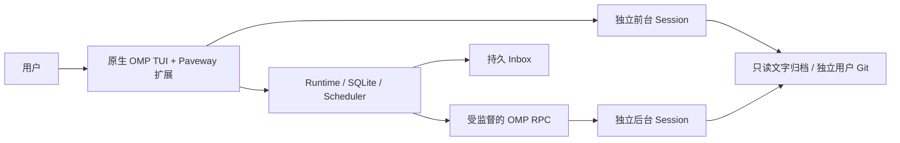

# Paveway

**Paveway is An adVanced Efficient Workflow for informAtics olYmpiads.**

Paveway 是基于 OMP（oh-my-pi）的 OI GPT 运行框架。原生 OMP TUI 负责聊天、流式回复、工具展示、滚动和 Session；Paveway 负责持久定时任务、独立 GPT Profile、配置快照、记忆、执行状态、恢复与用户数据 Git。

当前版本 **0.21.0**。固定 **10k 对话／记忆 token 限制已取消**，上下文窗口和压缩使用 OMP 原生机制。旧 CLI、管理 UI 和后台 RPC 入口保留，可回退。分阶段实现和测试证据见 [开发记录](docs/progress.md) 与 [原生验收](docs/verification/omp-native-acceptance.md)。

## 环境与安装

支持 Linux；本轮实际环境为 WSL2、Python 3.12.3、Bun 1.4.3、OMP 18.10.4。需要 Python 3.11+、venv/pip、Git，以及已安装并完成模型认证的 `omp`。登录自启需要可用的 systemd 用户服务。

```bash
git clone https://github.com/ETO-leader/Paveway.git
cd Paveway
python3 -m venv .venv
source .venv/bin/activate
python -m pip install -e '.[test]'
omp --version
./paveway.sh
```

一键脚本可从任意目录运行，会检查项目 `.venv`、初始化缺失配置、启动 Runtime 并进入原生界面；首次询问 Workflow 名称，已有配置、Prompt、Skills、历史和活动请求继续沿用。退出 UI 不停止后台 Runtime。

```bash
./paveway.sh --workflow test01
./paveway.sh --coach alpha
./paveway.sh --config /absolute/config.toml --workflow test01 --task training
./paveway.sh --legacy-ui
```

默认私密数据位于被 Git 忽略的 `.runtime/`。直接使用 CLI 时默认走 XDG 配置；要操作一键脚本的数据，请始终传同一 `--config`。

## 原生界面

输入 `/paveway` 用方向键和 Enter 选择。编辑器使用 OMP 原生提交键（本机为 Ctrl+Q），Esc 取消；编辑正文不会作为聊天消息发出。聊天、模型快捷选择、原生会话树与压缩继续使用 OMP 自身功能。

| 命令／菜单 | 功能 |
| --- | --- |
| `/paveway prompt` | 查看和编辑用户系统 Prompt，保留 append/replace 模式 |
| `/paveway skills` | 三类 Skills 的创建、查看、编辑、启停和删除 |
| `/paveway persona` | 编辑当前 GPT 的独立 Persona |
| `/paveway profile` | 创建／切换 GPT Profile、新对话、重启原生进程 |
| `/paveway model`、`thinking` | 跨设备保存模型／思考偏好，下次启动生效 |
| `/paveway memory`、`history` | Paveway 笔记 CRUD、原生历史分页与检索 |
| `/paveway events`、`recover` | 事件详情、取消／重排、明确确认后的恢复 |
| `/paveway sync` | 专用 Git remote、本地同步、冲突和跨设备文字归档 |
| `/paveway vjudge`、`tijian` | 遮罩登录输入、原生 Tijian MCP 配置 |
| `/paveway service`、`agent` | systemd 服务及后台 worker 管理 |
| `/paveway legacy` | 进入原管理 UI；退出后恢复原生对话 |
| `/paveway status`、`/coach` | Runtime 状态、绑定 Profile 与 Session |
| `/wakeup`、`/inbox` | 排程与持久消息，见下文 |

Paveway 不覆盖 OMP 原生 `/memory`、`/skills` 等命令。OMP 原生 Memory 和 Paveway 笔记是不同存储。当前只精确加载随包的 trusted extension，不自动发现其他用户 Extension；原生工具、Workspace MCP、Skills 和 Rules 继续受配置权限控制。

详细操作、异常状态和回退见 [原生 UI 使用说明](docs/native-ui.md)。

## GPT Profile、Prompt 与 Skills

Workflow 是可编辑的外部流程模板；GPT Profile 是逻辑身份。原 Workflow 自动作为同名默认 Profile；多个 Profile 可复用一份模板，并分别保存 Persona、私有 Prompt、Skills、记忆、状态与 Session。共享同一个 Tijian Workspace 并不等于共享聊天上下文。

```bash
export PAVEWAY_CONFIG="$PWD/.runtime/config.toml"
oicoach-runtime coach list --config "$PAVEWAY_CONFIG" --json
oicoach-runtime coach create alpha --workflow test01 \
  --persona-file /absolute/persona.md --config "$PAVEWAY_CONFIG"
oicoach-runtime native --coach alpha --new --config "$PAVEWAY_CONFIG"
```

新 Profile 不隐式复制源 Profile 的私人数据。`coach state show/put` 可维护带版本的通用状态；框架不擅自制定情绪或训练策略。

前台和后台共用 Prompt Composer，将框架事实、Workflow 指令、用户 Prompt、Persona 与记忆生成私密不可变快照，记录版本和摘要。旧 append/replace 文本及模式保留；使用原生 SYSTEM 加载，不继承默认 Coding Assistant 身份。GPT 使用 GPT 或第一人称自称；不会重写用户的 `event.md` 或自定义正文。

Skills 分为 **OI Introduce、user information、personal skill**，三类同时参与发现。上下文先包含索引与描述，正文由 OMP 按需读取；没有把所有正文固定塞入每一轮。每条 Prompt／Skill 正文上限为 64KiB，区别于已经取消的 token 预算。新 Prompt／Skill 快照在下次原生启动加载；**Persona 改动要求新的 Paveway Conversation**，原生 `/new` 仅创建当前快照下的另一个 OMP Session。

配置编辑采用 revision/CAS；并发修改会拒绝旧版本，不静默覆盖。CLI 入口见 `workflow customize --help`。

## 记忆与历史

Paveway 提供 Profile 与 task 两种作用域的长期笔记，包含 fact、preference、summary、hypothesis 分类、版本、来源、置顶及过期控制。GPT 可用 `paveway_memory_list/show/put/delete` 保存已确认的事实、偏好和进度，编辑前读取版本；子 Agent 将建议返回主 GPT，不使用主会话能力直接写入。

记忆快照保留 **64KiB 传输字节边界**，超出部分仍保存在笔记库，可按需检索；没有 10k token 裁剪。持久化成功后才能声称已记住，不保存凭据或隐藏推理。

原生 JSONL Session 是聊天原文来源。`frontend messages` 提供只读分页文字投影，保留 Session、entry/parent 与分支来源；不会改写 Session。`paveway_history_search` 可分别检索原生和后台历史。后台请求、最终回复和执行状态也可通过 `history`、`runs output` 查询。

```bash
oicoach-runtime memory list --workflow test01 --config "$PAVEWAY_CONFIG" --json
oicoach-runtime history search --workflow test01 --query 动态规划 --config "$PAVEWAY_CONFIG" --json
oicoach-runtime frontend list --config "$PAVEWAY_CONFIG" --json
oicoach-runtime frontend messages CONVERSATION_ID --query CF1A --offset 0 \
  --config "$PAVEWAY_CONFIG" --json
```

OMP 可能在新 Session 首次助手回复前暂存内容，不能保证强杀时保存尚未落盘的第一轮输入；已经持久化的原文保留，不自动重发。

只读归档沿用有界文件校验：单文件最多 16MiB、单行最多 1MiB；超过边界时拒绝归档并保留原文件，不能声称已同步。该限制不裁剪模型上下文，也不删除历史；可新建 Conversation 并保留旧来源。

## 定时任务与收件箱

```text
/wakeup in 10m 检查训练进度
/wakeup at 21:00 晚间提醒
/wakeup list
/wakeup cancel EVENT_ID VERSION
/wakeup reschedule EVENT_ID VERSION 2026-11-01T21:00:00+08:00
/inbox
/inbox 2
```

`in` 从 Runtime 提交请求时起算；`at HH:mm` 使用**系统时区**的下一次该时刻，完整 RFC3339 必须带时区。状态栏显示触发时间、秒级倒计时和未确认消息数。倒数到零不等于执行成功，实际状态来自 Runtime。

原生 AgentTool `paveway_wakeup_schedule/list/cancel/reschedule` 与上述命令使用同一持久队列，绑定当前 owner/generation 与作用域。仅按用户明确要求或现有 opt-in 排程，不自行建立无限跟进。已排程事件固定当时配置及模型快照；UI 退出不取消事件。

**前台没有严格 `after_turn_settled` 锚点**，不会将 `agent_end` 当作 settled；原有后台 CLI 的 `schedule --after-turn SECONDS --run-id RUN_ID` 保持严格 RPC 完成契约。

明确提醒在到期领取时先持久化，后台模型失败不会删除提醒；模型执行结果另存。created、offered、用户明确 acknowledged 分开，Run 成功不等于用户已读。当前使用持久 Inbox，重新打开 `/inbox` 查看；没有外部桌面／手机推送，也不自动向前台注入或重播消息。

## Tijian 与 VJudge

Paveway 使用上游 **原生 `tijian-mcp` stdio 服务**，不修改 Tijian、不复刻工具 Schema。先按 [Tijian 文档](docs/tijian.md) 构建或取得可执行文件，然后在菜单配置，或运行：

```bash
oicoach-runtime workflow connect-tijian test01 \
  --executable /absolute/tijian-mcp --read-only --config "$PAVEWAY_CONFIG"
# 需要业务写操作时，明确改用 --read-write；已有不同配置需人工核对。
```

配置写入 Workflow Workspace 的 **`.omp/mcp.json`**；首次显式连接可导入旧根 `.mcp.json`，原文件保留。文件仅当前用户可读写，冲突或 symlink 被拒绝。连接结果 `configured_not_verified` 仅表示配置已保存；实际握手与调用由 OMP 完成，修改后重启原生 Session。当前 OMP 可将 MCP 工具映射为 `xd://` 设备，通过原生 read/write 发现和调用，精确名称以实际服务为准。

已收录题目通过 `problem_get` 读取持久题面；缺题用 `problem_add`，缺题面或用户要求更新时用 `problem_refetch`。不每次重新爬取。`网页示例/` 是上游解析器开发样本，不是运行时题库。

`/paveway vjudge` 提供状态、测试、密码或 Cookie 登录及清除。输入遮罩并使用临时 0600 文件传递，密码不保存，不进入聊天或 argv；Cookie 存在 Tijian 对应的本机会话位置。CLI 也可 `oicoach-runtime vjudge auth login --config "$PAVEWAY_CONFIG"` 本地交互。

WSL2 Linux 与 Windows Desktop 默认数据目录不同；必须验证实际 MCP 使用的 Profile／题库位置，不能从 Linux 空库推断 Windows 题库为空。本轮验收的是实际 OMP + 本地 MCP fixture，未验证 Windows Tijian 真实题库。

## 独立 Git 与多设备

所有 GPT 对话和配置共用**一个独立用户数据仓库**，不使用源码 origin。未设置 dedicated remote 时仅维护本地 commit；设置后后台周期 pull/push。私有 Prompt、Skills、Persona 与文字历史会进入该仓库，因此应使用自己的私有远端；不在 URL 中嵌入 token。

可在 `/paveway sync` 配置，也可：

```bash
oicoach-runtime sync setup --repository /absolute/private-user-data \
  --config "$PAVEWAY_CONFIG"
oicoach-runtime sync remote --remote git@example.com:you/private-data.git \
  --config "$PAVEWAY_CONFIG"
oicoach-runtime sync now --config "$PAVEWAY_CONFIG"
oicoach-runtime sync conflicts --config "$PAVEWAY_CONFIG" --json
oicoach-runtime sync sessions --config "$PAVEWAY_CONFIG" --json
```

远端空字符串表示只保留本地 Git。配置冲突保留双方版本，使用 `sync resolve` 明确选择，不强推覆盖。另一设备用 `sync bind --workflow ID --workspace /absolute/local/workspace` 绑定本地路径。

归档保留结束后已登记 Session 的用户／助手文字与来源关系，不同步正在写入的原始 Session、tool 原文、隐藏思考、凭据、代理值或 owner capability。跨设备归档用于只读检索，不冒充能直接续写的原始 OMP Session。更多见 [用户数据同步](docs/git-sync.md)。

## 服务、CLI 与运行契约

如需独立启动，先激活 `.venv`，使用同一配置路径：

```bash
oicoach-runtime init --config "$PAVEWAY_CONFIG"
oicoach-runtime doctor --config "$PAVEWAY_CONFIG" --json
oicoach-runtime serve --config "$PAVEWAY_CONFIG"  # 前台运行 daemon
# 另开终端：
oicoach-runtime native --workflow test01 --config "$PAVEWAY_CONFIG"
oicoach-runtime ask --workflow test01 --task training --message '测试请求' \
  --wait --config "$PAVEWAY_CONFIG"
```

`init` 不启动服务；新配置需要 `workflow create ID --workspace /absolute/existing/workspace`，一键脚本则自动引导。`ask` 使用后台队列，原生聊天直接进入前台 OMP，两者使用不同物理 Session。

登录自启：

```bash
oicoach-runtime service install --config "$PAVEWAY_CONFIG"
oicoach-runtime service enable --now --config "$PAVEWAY_CONFIG"
oicoach-runtime service status --config "$PAVEWAY_CONFIG" --json
oicoach-runtime service logs --config "$PAVEWAY_CONFIG"
```

服务采用 systemd user；登出后持续运行还取决于系统的 linger 设置。启动时同步已有 OMP 代理配置并检查连接，不把代理值写入源码 Git。具体配置和进程监督见 [部署](docs/deployment.md)、[工作流契约](docs/workflow-contract.md) 和 [本地 API](docs/runtime-api.md)。



后台完成依次检查 prompt_result、settled、持久 Session 与正常退出；命令接收成功不是执行成功。前台生命周期仅为观测，不生成虚假的严格 Run 完成证据。能力以 owner/generation 和物理文件锁隔离；心跳超时不证明进程死亡，不允许另一进程接管活 Session。

## 故障恢复与回退

- `daemon_unavailable`：确认 CLI/UI 使用同一配置，检查 `service status/logs` 或前台 `serve`。升级旧 daemon 时应先确认空闲，再重启；不打断活动请求来加载新协议。
- `uncertain`：先检查历史及外部副作用，不自动重发。`frontend list/show/recover` 在验证旧进程死亡及锁释放后显式恢复原生所有权；若 Session 未落盘／损坏，保留旧记录并用 `native --new`。
- Profile／Persona 或 Workflow revision 变化：新建 Conversation，旧对话和快照保留。
- 模型／MCP 不可用：检查原生连接状态及配置，排程成功不证明模型或工具已执行。
- 回退界面：`./paveway.sh --legacy-ui` 或 `PAVEWAY_UI=legacy ./paveway.sh`；旧 `ui`、CLI 和 RPC 都保留。

没有本轮 schema migration，原表语义保留；切回旧 UI 与降级旧二进制不同。旧二进制可能不认识新增 Persona/coach 字段，需停服务并使用私密配置备份回退，不删除用户数据，不借恢复操作重放未知请求。

## 验证与源码边界

```bash
PYTHONPATH=src:tests .venv/bin/python -m unittest discover -s tests
PAVEWAY_TEST_NATIVE=1 PYTHONPATH=src:tests .venv/bin/python -m unittest \
  test_native_omp test_native_management test_native_capabilities test_native_recovery -v
```

原生测试使用实际 OMP／PTY／工具、本地 HTTP provider 和 stdio MCP fixture，不使用私人模型认证或付费请求；Browser 测试需要本机 Chrome，缺失时明确跳过。旧 `verify-omp --with-model` 是另一个显式 opt-in，会调用你配置的真实模型。

源码只保存工程实现、模板、项目 Skill 和文档。运行配置、自定义 Skill 正文、会话、代理值和凭据应留在私密数据目录，不能提交到源码仓库；专用用户 Git 是独立机制。历史 Guard／M0 探针作为调查材料保留，不进入默认运行路径，也不表示仍实施 10k 限制。
