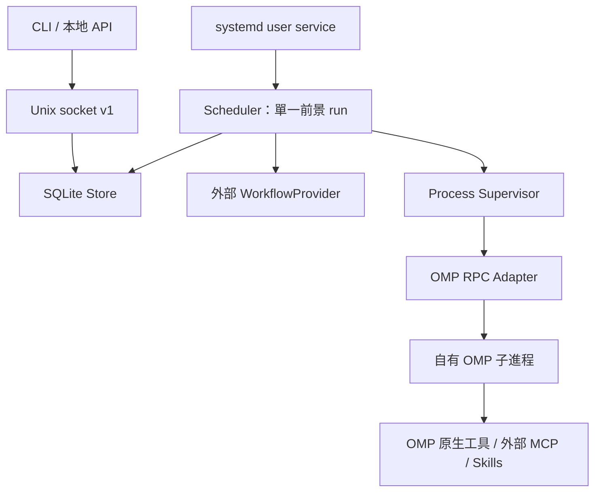

# Runtime 架構 v1

狀態：M1 已實作；需求來源為 `documents-for-agents/introduce.md`，工程順序依 `.codex/skills/SKILL.md`。

## 已實作

Python 3.11+、Linux；執行期僅用標準庫。`oicoach-runtime` 入口位於 `src/oicoach_runtime/cli.py`，提供初始化、診斷、常駐服務、排程與恢復管理。

| 組件 | 責任 |
| --- | --- |
| `config.py` | TOML v1、XDG 路徑、配置與私密目錄驗證 |
| `db.py`、`migrations/001_initial.sql` | SQLite WAL、交易式 migration、拒絕未知 schema、唯讀診斷 |
| `models.py` | 事件狀態詞彙、RFC3339 → UTC、task/session scope 雜湊 |
| `workflows.py` | 讀取外部 manifest、限制模板路徑和變數；不執行模板程式碼 |
| `doctor.py` | 配置、私密權限、DB、workflow、OMP version/help 探測 |
| `store.py` | 排程、去重/CAS、claim、完成證據、session 綁定、恢復及 audit |
| `ipc.py` | 有界版本化 JSONL、Unix socket、同 UID 檢查 |
| `scheduler.py` | 單一 run、workflow envelope、先 commit intent 再送 prompt |
| `adapters/omp_rpc.py` | RPC v1、獨立超時、stderr drain、ack/result/settled |
| `processes.py`、`child.py` | flock、持鎖 guardian、Linux parent-death 程序組清理 |

fake OMP 已驗證完整流程。adapter 能啟動配置指定的 executable，但本輪尚未用真實 OMP 發送模型 prompt；不把 fake 驗證當作真實服務驗證。沿用 M0 的 schema v1，不改既有資料表或刪除記錄。

## 依賴方向

核心不 import Tijian，不在 scheduler 寫 OI 提示或訓練決策。Workflow 提供可信模板及會話策略，事件 payload 作資料處理。systemd 箭頭仍為 M4 目標，目前沒有安裝服務。

## 固定工程語義

- Store 連線設定 `foreign_keys=ON`、`busy_timeout=5000`、`synchronous=FULL` 並驗證 WAL。交易失敗回滾，事件與 audit 同時 commit。
- 全 Runtime 同時最多一個 `leased/running` run；schema 以 partial unique index 作最後防線。
- 時刻統一以固定六位小數 UTC 字串儲存，程序內等待使用 monotonic clock；啟動後重新計算 wall-clock 到期狀態。
- 送 prompt 前持久化 dispatch intent；崩潰後不能證明完成的送出進入 `uncertain`。
- session scope 使用 `SHA256(workflow_id + NUL + task_id)`，避免路徑穿越及 task 間串會話。
- schema、manifest、CLI/API 各自版本化。未來升級需 migration、升級前 SQLite backup 和故障回滾測試；目前只支援建立 v1，遇到其他版本明確拒絕。

## 驗收順序

| 階段 | 交付與閘門 | 目前狀態 |
| --- | --- | --- |
| M0 | 契約、空 DB migration、init、doctor、workflow 驗證 | 已實作與測試 |
| M1 | Unix IPC、持久排程、串行 scheduler、fake OMP、daemon 重啟保留事件 | 已實作與測試 |
| M2 | 真實 RPC、完成與 settled 訊號、per-task session 接續與隔離 | fake 已通過，真實 OMP 待驗證 |
| M3 | backoff、circuit breaker、自動重啟、agent restart | 待實作；flock、基本 reconciliation、人工恢復已提前至 M1 |
| M4 | systemd、完整狀態與操作診斷、部署與外部接入 | 待實作 |

M1 仍未完成完整框架十項驗收。啟動前失敗直接 blocked，未知副作用列 uncertain，兩者都保守地等待人工恢復；restart 配置欄位目前保留，尚未啟用自動重試。每次 wake 建立一個 OMP 子進程，結束並 settled 後回收；後續以已驗證的明確 session file 恢復，不用全域 continue。
