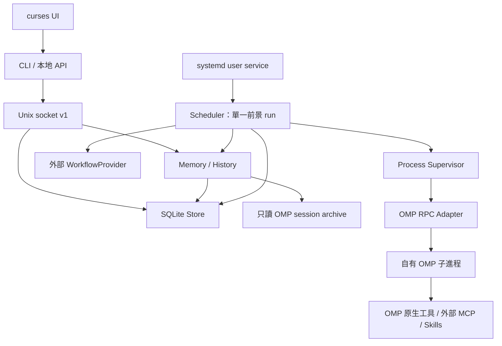

# Runtime 架構 v1

狀態：0.8.0 已實作 M0–M4、L2 筆記、L3 歷史檢索與終端 UI；需求來源為 `documents-for-agents/introduce.md`，工程順序依 `.codex/skills/SKILL.md`。另附獨立、可編輯的初版 coach workflow；記憶提煉策略在外部模板中。

## 已實作

Python 3.11+、Linux；核心與 Tijian CLI 適配僅用標準庫，MCP bridge 使用可選 SDK。`oicoach-runtime` 入口位於 `src/oicoach_runtime/cli.py`，提供初始化、診斷、常駐服務、排程與恢復管理。

| 組件 | 責任 |
| --- | --- |
| `config.py` | TOML v1、XDG 路徑、配置與私密目錄驗證 |
| `db.py`、`migrations/*.sql` | SQLite WAL、v1→v2 交易式 migration、拒絕未知 schema、唯讀診斷 |
| `models.py` | 事件狀態詞彙、RFC3339 → UTC、task/session scope 雜湊 |
| `workflows.py` | 讀取外部 manifest、限制模板路徑和變數；不執行模板程式碼 |
| `doctor.py` | 配置、私密權限、DB、workflow、OMP version/help 探測 |
| `store.py` | 排程、去重/CAS、claim、完成證據、session 綁定、恢復及 audit |
| `ipc.py` | 有界版本化 JSONL、Unix socket、同 UID 檢查 |
| `scheduler.py` | 單一 run、workflow envelope、先 commit intent 再送 prompt |
| `adapters/omp_rpc.py` | RPC v1、獨立超時、stderr drain、ack/result/settled |
| `processes.py`、`child.py` | flock、持鎖 guardian、Linux parent-death 程序組清理 |
| `smoke.py` | 真實 OMP transport／三回合模型驗證，暫存 workspace 與 daemon |
| `supervisor.py` | 可注入時間／亂數的退避、冷卻與熔斷策略；Store 原子持久化 |
| `integrations/tijian*.py` | 外置 Tijian 操作/schema、JSON CLI 進程適配與可選 stdio MCP bridge；不存取 Tijian DB |
| `service.py` | 生成／校驗／安裝及管理屬於當前 config 的 systemd user unit；安裝不啟用 |
| `workflow_setup.py`、`bundled/*.md` | 安裝可編輯的外部 coach/example 模板，合併專案 Tijian MCP 配置 |
| `memory.py` | 通用 scoped 筆記/CAS/有效期/有界注入；只讀查詢既有 run 與 OMP 原文，不包含 OI 記憶提煉策略 |
| `tui.py` | curses 終端前端，背景執行公開 CLI 子進程；不直接讀寫 DB、不接管 daemon 生命週期 |

fake OMP 持續驗證故障與競態；本機 OMP 18.10.4 另通過真實模型回合、兩次喚醒續聊與跨 task 隔離。verify-omp 可在每個環境重現。0.7.0 只新增 memory_notes 表，DB 升級到 v2；既有 queue/run/session/output 不刪除或重播。

## 依賴方向

核心不 import Tijian，不在 scheduler 寫 OI 提示或訓練決策。Workflow 提供可信模板及會話策略，事件 payload 作資料處理。systemd 部署入口已實作並以獨立 UUID unit 實測；目前沒有啟用使用者的預設服務。

## 固定工程語義

- Store 連線設定 `foreign_keys=ON`、`busy_timeout=5000`、`synchronous=FULL` 並驗證 WAL。交易失敗回滾，事件與 audit 同時 commit。
- 全 Runtime 同時最多一個 `leased/running` run；schema 以 partial unique index 作最後防線。
- 時刻統一以固定六位小數 UTC 字串儲存，程序內等待使用 monotonic clock；啟動後重新計算 wall-clock 到期狀態。
- 送 prompt 前持久化 dispatch intent；崩潰後不能證明完成的送出進入 `uncertain`。
- session scope 使用 `SHA256(workflow_id + NUL + task_id)`，避免路徑穿越及 task 間串會話。
- schema、manifest、CLI/API 各自版本化。DB 支援已知 v1→v2 原子遷移，新建直接到 v2；升級前 SQLite backup，遷移失敗回滾，拒絕未知版本。配置/manifest/API 仍為 v1。

## 驗收順序

| 階段 | 交付與閘門 | 目前狀態 |
| --- | --- | --- |
| M0 | 契約、空 DB migration、init、doctor、workflow 驗證 | 已實作與測試 |
| M1 | Unix IPC、持久排程、串行 scheduler、fake OMP、daemon 重啟保留事件 | 已實作與測試 |
| M2 | 真實 RPC、完成與 settled 訊號、per-task session 接續與隔離 | 本機 OMP 18.10.4 與模型實測通過；提供可重現命令 |
| M3 | backoff、circuit breaker、安全自動重啟、agent restart | 已實作；daemon 的服務管理器部署仍屬 M4 |
| M4 | systemd、狀態與操作診斷、部署與外部接入 | 已實作並以實際安裝的 user unit 驗證；Tijian 原碼 CLI/MCP 全鏈路通過 |
| 記憶 | L2 scoped 筆記、L3 歷史、模型維護及有界注入 | 0.7.0 已實作；真實模型寫入、重啟及新 task 讀取通過 |
| 終端 UI | 經公開 CLI 執行對話、事件、記憶、歷史、workflow 和服務 | 0.8.0 已實作；中文 PTY、退出後任務繼續完成已測 |

M3 的 systemd 部署驗收已在 M4 補齊。每次 wake 建立新 OMP 進程，完成、settled 且正常退出後才 commit 成功，後續以明確 session file 恢復。僅啟動階段且未記錄 dispatch intent 的傳輸／進程失敗可自動重試；永久 workflow/session 錯誤 blocked，送出後不確定則 uncertain。provider error 或執行中 crash 可增加熔斷計數，但不重送該 prompt。

全域策略存在 runtime_metadata 的 supervisor_v1，含版本、有限失敗時間窗、連續次數、next_start_utc、open_until_utc。每個 run 結果、事件轉移、策略更新與 audit 以同一交易 commit。DB v2 保留既有結構。cooldown/backoff 擋住新 claim，不阻擋控制 IPC。到期後僅串行放行一個 probe run；成功清除故障計數，失敗重新開啟冷卻。

Runtime 與 guardian 都使用 Linux subreaper；OMP root 在 guardian 死亡時也收到 parent-death signal，並保留 Runtime flock 直到退出。adapter 用 pidfd 對自有 guardian 發送信號，監控 returncode 避免孤兒工具持有 pipe 導致長時間漏判退出，並清理收養的同組後代。此機制針對受管程序組；M4 仍需 service cgroup 的完整服務生命週期邊界。

每個 adapter 共享一個 cancellation-shielded cleanup task；restart 或 shutdown 取消派發等待時，後續清理會等待同一個有界 stop，避免重複讀 pipe、提前關閉 pidfd 或讓前後兩個進程重疊。
