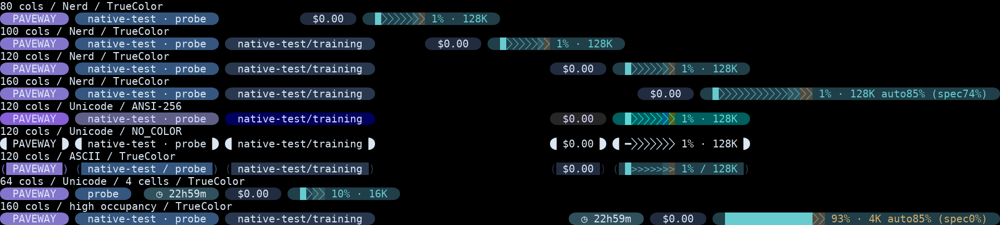
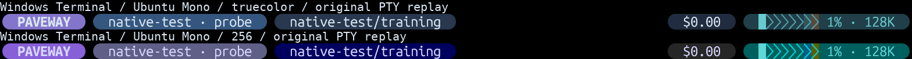

# Context Dual-limit Rail 验收

## 根因与修改范围

旧实现把 `floor(width × limit / 100)` 得到的单格绑定到 `markers`，在 Chevron 上叠加 SGR `4`／`4;1`；相近阈值会覆盖，Windows Terminal 的下划线也会打断胶囊视觉。现在删除这条样式路径，复用 `palette()`／`ANSI_TOKENS`，不增加着色系统。

- `paveway-statusline.mjs`：新增三个颜色 Token 和私有 `contextRail()`；`contextMeterCells()` 从现有 `snapshot.context` 读取阈值；`renderCapacity()` 直接绘制单元背景，不再插入阈值属性。
- `paveway-statusline.test.mjs`：用背景、前景、占用和状态语义替换旧标记断言；保留无样式泄漏检查。
- `test_native_statusline.py`：真实宿主下检查色带、数值色、禁色及动画；修正测试解析器把 `(spec…)` 的括号当作胶囊边界的问题。
- `docs/native-ui.md`：更新使用说明。本目录仅保存隔离 fixture 的视觉材料及哈希，不保存用户配置、凭证或会话。

关键调用变化：

```js
const cells = contextMeterCells(context.percent, meterWidth, {context});
// 未用格的光流仍只选择 foreground。
return paint(text, cell.background, foreground);
```

自动压缩业务、OMP 快照协议、宽度预算、圆帽／Chevron 选择、动画相位和 125ms 调度均未修改。

## 阈值与占用规则

只有 `autoCompact === true` 才启用色带和越线提示。沿用既有 `knownPercent()`：非数值、缺失、NaN、Infinity 均未知；有限值钳制到 0–100。

```js
specStart = Math.ceil(meterWidth * speculationPercent / 100);
autoStart = Math.ceil(meterWidth * thresholdPercent / 100);
```

未占用格：先判断 Auto，再判断 Spec，否则 Normal。缺失边界视为不存在；仅 Spec 可用时延续至条尾，仅 Auto 可用时直接从 Normal 进入 Auto。Spec 大于 Auto 时忽略 Spec，不交换或移动阈值；相同边界由 Auto 优先。0% 起点为首格，100% 起点为条外；分辨率不足时允许某区间没有单元，不补造刻度，也不增加紧凑文案。

| 格数，Spec=75 / Auto=85 | Normal 下标 | Spec 下标 | Auto 下标 |
| --- | --- | --- | --- |
| 0 | 无 | 无 | 无 |
| 4 | 0–2 | 3 | 无 |
| 8 | 0–5 | 6 | 7 |
| 16 | 0–11 | 12–13 | 14–15 |

占用量化不变：0% 不填充；100% 全满；其余正占用在有空间时至少一格且保留至少一个未用格。已用格始终统一 cyan，覆盖底下的阈值区间。数值前景按**未四舍五入的真实占用率**判断：低于 Spec 为 cyan，达到 Spec 为 Notice，达到 Auto 为 Warning；未知占用不报警，但已知阈值仍可显示静态色带。宽屏精确 `auto… (spec…)` 和关闭后的 `auto off` 继续使用原有预算。

## 配色与视觉结论

| 职责 | TrueColor | ANSI-256 | ANSI RGB |
| --- | --- | --- | --- |
| Normal 背景 | `#203f49` | 23 | `#005f5f` |
| Spec 背景 | `#30545b` | 24 | `#005f87` |
| Auto 背景 | `#574939` | 58 | `#5f5f00` |
| 已用区／正常数字 | `#67cbd0` | 80 | `#5fd7d7` |
| Spec 数字 | `#a6c9c2` | 152 | `#afd7d7` |
| Auto 数字 | `#d5ab68` | 179 | `#d7af5f` |

保留初始 TrueColor 候选：实际重绘中 Spec 克制、Auto 与青色有区别，未见额外分隔缝。ANSI 显式固定三个不同色号，避免近邻量化合并；Auto 在 256 色下偏橄榄棕而非 TrueColor 的暖棕，Spec 偏蓝，是有限色域的可见差异。4 格的颜色变化仍是整格，未出现闪烁的阈值亮块；越线后不改变已用区颜色。

下图为真实原生 PTY 的状态行裁切，字体重绘使用 DejaVu Sans Mono Nerd Font v3.4.0。128K 宿主的实际 Spec 为 74.375%，16K 为 33.8%，4K 为 0%；没有把宿主数据改造成 75% 示例。75%／85% 的精确映射由单元测试覆盖。



| 真实场景 | 六帧对照 | 动画 |
| --- | --- | --- |
| 8 格 TrueColor | [图片](bubble-chevron-8-truecolor-frames.png) | [GIF](bubble-chevron-8-truecolor.gif) |
| 8 格 ANSI-256 | [图片](bubble-chevron-8-256-frames.png) | [GIF](bubble-chevron-8-256.gif) |
| 16 格 TrueColor | [图片](bubble-chevron-16-truecolor-frames.png) | — |
| 16 格 ANSI-256 | [图片](bubble-chevron-16-256-frames.png) | — |
| 4 格 TrueColor | [图片](bubble-chevron-4-truecolor-frames.png) | — |
| 4 格 ANSI-256 | [图片](bubble-chevron-4-256-frames.png) | — |

各动态场景捕获 17 个实际帧，检查首尾闭合；背景位置、字符、占用格和非 Context 单元不变。GIF 沿用证据工具的 120/130ms 交替编码，平均 125ms，不改变运行时周期。

### Windows Terminal

下面是**真实 Windows Terminal 窗口**中回放同一隔离 PTY 原始 ANSI 的截图裁切，不是 Pillow 重绘。使用 `PrintWindow(PW_RENDERFULLCONTENT)` 只捕获专用窗口，按实际 DPI 保存；背景、字体设置和 Powerline 策略未修改。默认字体配置为 Ubuntu Mono，具体 glyph fallback 未识别。完整窗口原图保留于 Windows 临时目录，哈希见 manifest。



TrueColor 和 ANSI-256 的 Chevron 连续、圆帽完整，未见下划线或明显分区接缝。此截图验证栅格化，不是 Windows 原生进程运行 OMP，也不是 Windows Terminal + 指定 Nerd Font 的完整组合认证。第一次截图探针误用默认 WSL 发行版，未能启动；改为显式 `wsl.exe -d Ubuntu --cd /tmp` 后成功，不修改 `/etc/wsl.conf`。

## 验证结果

- Bun 1.4.2：`96 pass / 0 fail`，26,835 个断言。覆盖 0／4／8／16 格，0／1／74／75／84／85／99／100% 占用，未知值、缺失／相同／逆序／相近／端点阈值、关闭压缩，三种颜色模式、Nerd／Unicode／ASCII、环境覆盖优先级及窄屏预算。
- 原生 PTY：已执行现有 13 项测试；隔离宿主首轮 10 项通过，3 项因上述测试边界解析器失败。修正后只重跑受影响的 3 项，全部通过，89.960 秒；其余已通过项未重复执行。矩阵含 4／8／16 格的 TrueColor／ANSI-256／NO_COLOR、80／100／120／160 列、工作／空闲／取消／关闭动画、真实高占用及 auto off。
- 原生启动首先发现全局 OMP 为 18.18.3，与仓库锁定的 18.16.0 不符。通过临时 PATH 启用已有缓存的真实 18.16.0 启动器完成验证；未伪造版本、修改全局安装或用户配置。取消流式 fixture 时出现 `ConnectionResetError`，对应测试通过，未隐藏异常。
- 额外的一次性前后对照使用修改前的 HEAD renderer 与当前 renderer：1,944 个帧的可见字符／布局完全相同，非 Context 前缀字节完全相同，覆盖三种 preset、三种颜色模式、8–160 列、九种占用率及三个 phase。临时对照脚本不纳入仓库。
- `render_statusline_evidence.py` 成功重绘 242 组配对原生捕获；本目录精选 10 个视觉文件，manifest 记录 112 组相关输入的 JSON／ANSI 哈希及输出哈希。全部原始捕获位于 `/tmp/paveway-context-rail`，完整重绘位于 `/tmp/paveway-context-rail-rendered`，临时目录不承诺持久保存。

## 复现

```bash
bun test tests/paveway-statusline.test.mjs

# 若全局 OMP 不是 18.16.0，使用仓库已准备好的真实隔离启动器；不覆盖全局 omp。
mkdir -p /tmp/paveway-rail-bin
ln -s "$PWD/src/oicoach_runtime/bundled/omp/omp" /tmp/paveway-rail-bin/omp
PATH="/tmp/paveway-rail-bin:$PATH" PYTHONPATH=src:tests PAVEWAY_TEST_NATIVE=1 \
  PAVEWAY_STATUSLINE_EVIDENCE=/tmp/paveway-context-rail \
  .venv/bin/python -m unittest test_native_statusline -v

curl --fail --location \
  --output /tmp/Paveway-DejaVuSansMNerdFontMono-Regular.ttf \
  https://raw.githubusercontent.com/ryanoasis/nerd-fonts/v3.4.0/patched-fonts/DejaVuSansMono/Regular/DejaVuSansMNerdFontMono-Regular.ttf
.venv/bin/python tests/render_statusline_evidence.py /tmp/paveway-context-rail \
  --font /tmp/Paveway-DejaVuSansMNerdFontMono-Regular.ttf \
  --wide-font /mnt/c/Windows/Fonts/msyh.ttc \
  --context-only --output /tmp/paveway-context-rail-rendered
```

需先准备仓库锁定宿主；安装流程见 [原生 UI](../../native-ui.md)。重复运行时可选择新的临时 launcher 目录，或复用已存在的链接。CJK 字体路径仅为证据生成输入，不是运行时依赖。

## 剩余视觉风险

- ANSI-256 的色相／饱和度无法完全匹配 TrueColor，尤其 Auto 的偏橄榄棕；用户自定义终端调色板和显示器可能改变感知。
- Windows Terminal 的实际 Nerd Font、回退字体、行高、缩放与内置 Powerline 绘制组合仍需用户实机确认；不能把本次默认字体截图或 Nerd Font 重绘当作所有组合的像素保证。
- 粗粒度格子不保证显示每个阈值区间；阈值在条外、重合或被占用填充覆盖均属正确语义。精确数值只在原有预算容纳时出现，窄屏不新增标记。

没有自动 commit 或 push。
