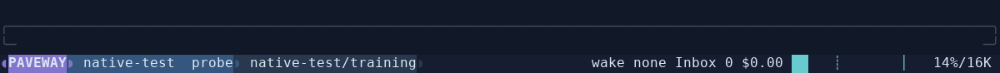
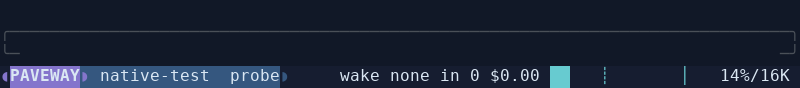
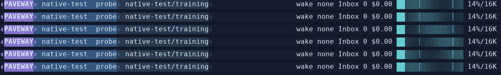
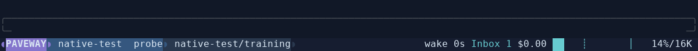

# Windline 状态栏验收

> 本页保留 `3483322` 集成基线的截图和测试结果，不代表独立 Bubble 改造后的复测结果。当前设计、真实新图及修正记录见 [Bubble 验收](windline-statusline/bubble-verification.md)。

## 实际运行范围

- 原入口：`omp/18.16.0` 编译版。该版本交互扩展的 `setFooter()` 确实为空实现。
- 前台宿主：OMP `v18.16.0`，commit `650f3a108229ee11bf68ba3377f4e8c3391cd424`，应用随包 `bundled/omp/statusline.patch`。
- 实际启动链路：Paveway native → 私有 PTY guardian → 隔离 Linux Bun → 补丁后的 OMP CLI → Paveway trusted extension → OMP StatusLine。
- 模型服务使用已有隔离 loopback fixture，没有访问付费模型、用户认证、用户 Runtime 或用户会话。`native-test`、`probe`、长模型 ID、容量和 Inbox 均来自该真实运行 fixture 的配置／Runtime，不是状态栏硬编码演示值。
- 图片由实际 PTY 输出经项目 `WideScreen` 解码后的终端单元生成；不是概念图，也不是桌面终端窗口的系统截图。字形使用本机 DejaVu Sans Mono 重绘，保留实际字符、前景／背景色和单元位置。

## 实际画面

### 120 列空闲



### 80 列紧凑



### 工作中的连续帧

[32 帧实际录制 GIF](windline-statusline/working.gif)，每帧采样约 125ms。下图选取其中六帧，顺序为 0、6、12、18、24、30：



在这次 14%／16K 的真实状态中，16 格容量条有 2 格已使用、14 格未使用。对 32 帧的终端单元逐格检查：文本只有一个版本，2 格已使用背景只有一个版本，颜色变化只发生在其余 14 格。取消后再次采样，整个状态栏单元保持相同；`tui.motion: false` 时工作中也保持相同。

### 真实高占用与未读消息




高占用场景通过实际向 4K 窗口的隔离模型提交长输入达到 95%，该场景显式关闭自动压缩以观察容量边界。Inbox 的 2 条是 Runtime 保存的提醒和后台结果；展示没有自动确认或重放。

### 长字段、Resize 与 Session

- [80 列长模型名](windline-statusline/long-80.png)：先隐藏次要身份字段，模型保留可读前缀和省略号，不留下三字碎片。
- [120 列长字段](windline-statusline/long-120.png)。
- [160 列完整边界说明](windline-statusline/wide-160.png)。
- [原生 `/new` 后](windline-statusline/session-switch.png)：同一进程重新绑定后状态栏仍只有一条；随后实际完成一次聊天。
- 120 → 80 → 100 → 160 → 120 实际 Resize，未提交草稿逐次保留。输入框仍是原生 `box` 边框，没有切换成 `pi`。

## 设计迭代

首次实际截图暴露两个问题，均已修改并重新验收：

- 120 列的 `auto… (spec…)` 长说明挤占身份空间。改为 160 列才显示完整说明，其余宽度用条内固定阈值标记；标记不覆盖已使用区。
- 长模型名把 Coach／Workflow 压成过短色块。改为可读宽度预算，空间不足先隐藏 Workflow、再隐藏次要身份。Coach 和模型共用蓝色身份表面，减少零碎色块。

保留紫色品牌、蓝色身份、蓝灰 Workflow、青色容量的统一层级。只有容量剩余区承担动态；不增加品牌闪烁、移动图标或整条呼吸效果。

## 验证结果

| 验证 | 实际结果 |
| --- | --- |
| Paveway renderer／Wakeup Bun 测试 | 37 通过，0 失败 |
| OMP StatusLine 全部相关套件 | 92 通过，3 跳过，0 失败 |
| OMP TUI TypeScript | 通过 |
| OMP coding-agent TypeScript | 通过 |
| Paveway Python 全套，使用 Linux Bun | 417 项，56 跳过，0 失败 |
| 原有 native chat／management／recovery PTY 套件 | 32 通过 |
| 新增实际状态栏 PTY 场景 | 4 通过；工作路径又单独以 32 连续帧通过 |
| Wheel 分发 | 构建成功；临时安装后的 bundled launcher 可执行，复用宿主并输出 `omp/18.16.0` |

额外运行 OMP 的 extensions-runner、autoresearch-state、approval-cached-mode、xdev-approval-gate 四个套件：143 通过，1 失败。失败为 `approval-cached-mode.test.ts` 的目录枚举顺序断言（期望 entry-000…003，实际 entry-005…008）；没有修改目录扫描逻辑或重新固定该断言，不把这次额外检查宣称为全通过。

首次 Python 全套检查误用了 PATH 中的 Windows Bun，导致 4 个 guard/tokenizer 检查失败；明确选择隔离宿主的 Linux Bun 后，全套通过。首次宿主安装还遇到现有全局 Bun 缓存中的 0 字节包文件；安装器改用独立依赖缓存后成功，没有清理原缓存。另用临时安装路径验证并修正了缓存 manifest 持有旧源码路径时的 launcher 重定位。

取消测试中 loopback HTTP 服务可能记录 `ConnectionResetError`：这是实际取消关闭流后 fixture 继续写响应产生的诊断；相关取消、空闲、Inbox 和所有权断言均通过，没有吞掉该异常日志。

## 复现

```bash
.venv/bin/python packaging/omp/install.py
CACHE="${PAVEWAY_OMP_CACHE:-$HOME/.cache/paveway/omp/18.16.0}"
BUN="$CACHE/bun-1.4.4/bin/bun"
OMP_SOURCE=$(.venv/bin/python -c 'import json,os,pathlib; root=pathlib.Path(os.environ.get("PAVEWAY_OMP_CACHE",str(pathlib.Path.home()/".cache/paveway/omp/18.16.0"))); print(json.loads((root/"runtime.json").read_text())["source"])')
export PATH="$(dirname "$BUN"):$PATH"
export NODE_PATH="$OMP_SOURCE/node_modules"

"$BUN" test tests/paveway-statusline.test.mjs tests/paveway-wakeup-status.test.mjs
.venv/bin/python -m unittest discover -s tests
PAVEWAY_TEST_NATIVE=1 PYTHONPATH=src:tests .venv/bin/python -m unittest test_native_omp test_native_management test_native_recovery
PAVEWAY_TEST_NATIVE=1 PAVEWAY_STATUSLINE_EVIDENCE=/tmp/paveway-statusline-evidence .venv/bin/python -m unittest discover -s tests -p test_native_statusline.py -v

(cd "$OMP_SOURCE" && "$BUN" test packages/tui/test/status-line-*.test.ts)
(cd "$OMP_SOURCE/packages/tui" && "$BUN" run --bun check:types)
(cd "$OMP_SOURCE/packages/coding-agent" && "$BUN" run --bun check:types)
```

证据目录由 PTY 测试写入实际 `.ansi` 输出和 `.json` 单元记录，不含用户会话；图片只截取记录里的编辑器及状态栏区域。

## 保留的边界

- 集成版本固定为 OMP 18.16.0；当前预制 Bun／原生插件下载目标为 Linux x86-64 glibc。其他平台／版本未宣称支持。
- 第一次准备需要网络和 Git；已准备缓存可离线启动。没有更改全局 OMP、后台 Worker 配置或 Runtime 持久化协议。
- 不强制 Alternate Screen。OMP 原本的 Resize 临时借屏行为保留；验收检查正常聊天不进入 Alternate Screen，Resize 后 enter／leave 成对结束。
- Nerd 字形及 256 色／无色降级有确定性渲染检查；没有把终端单元重绘图片当成特定实体终端、Nerd Font 安装或硬件渲染认证。

## 参考实现

- [Windline wind.lua](https://github.com/windwp/windline.nvim/blob/master/lua/wlsample/wind.lua)：各位置颜色相位差，而非移动文本。
- [Windline bubble.lua](https://github.com/windwp/windline.nvim/blob/master/lua/wlsample/bubble.lua)：`basic.right` 使用前景等于组件背景、外部背景等于状态栏的成对圆帽；此前将其概括为连续 Powerline 连接并不准确，本次 Bubble 改造已纠正。
- [OMP 固定源码](https://github.com/can1357/oh-my-pi/tree/650f3a108229ee11bf68ba3377f4e8c3391cd424)：复用 StatusLine、Composer、真实会话统计和 TUI 重绘。没有引入 Neovim 插件依赖。
