# Windline 独立 Bubble：实际验收记录

## 结论与运行边界

已在现有 Paveway → PTY guardian → OMP 18.16.0 → trusted extension → StatusLine 链路上完成改造。只修改状态栏展示；宿主补丁、Transcript、Scrollback、Composer、Wakeup 排程、Inbox 确认、Runtime 所有权／通知／持久化协议均未修改，没有更新或重新安装 OMP。

图片来自 `tests/test_native_statusline.py` 启动的真实隔离 OMP TUI：loopback 模型、隔离 Runtime、实际终端输出 → `WideScreen` 单元记录 → 字体重绘。不是概念图、renderer 人工快照或桌面窗口截图。`native-test`、`probe`、128K／16K／4K、费用及消息数来自 fixture 的真实配置和运行状态；没有访问付费模型或用户配置、凭证、会话和 Runtime。

源码参考已实际阅读：[Windline bubble.lua](https://github.com/windwp/windline.nvim/blob/master/lua/wlsample/bubble.lua) 的 `basic.right`、`basic.vi_mode` 和默认组件布局，以及 [helpers.lua](https://github.com/windwp/windline.nvim/blob/master/lua/windline/helpers.lua) 的 `left_rounded`／`right_rounded` 定义。借鉴独立圆帽和前景／背景搭配，不引入 Neovim 依赖。

## 设计与关键 Diff

| 组件 | 背景 | 展示策略 |
| --- | --- | --- |
| PAVEWAY | `#8475cc` | 紫色品牌，粗体 |
| Profile／Model／Thinking | `#35577f` | 单一蓝色身份胶囊；优先显示模型显示名，缺失回退 ID |
| Profile/task | `#29384e` | 蓝灰次要信息，80 列不显示 |
| Wakeup／非零 Inbox | `#30505c` | 有事件／消息才显示 |
| Cost | `#222c40` | 低对比度，预算不足先于关键信息隐藏 |
| Context | `#203f49` | 青色文字、紧凑实心容量条；未用区同表面底色 |
| Runtime／未知状态 | `#633c4b` | 浅色粗体异常提示，最高保留优先级 |

- 删除 `fields` 连续色带、共享 `connection`、右侧纯文字 `metadata` 和单独的窄屏纯文字分支。
- `bubble(item, content)` 同时负责左右两组：`paint(leftCap, night, item.background)` + 内边距／内容 + `paint(rightCap, night, item.background)`。左右圆帽前景等于自身胶囊背景，不借用相邻组件背景。
- 常规胶囊两侧各一列内边距，胶囊间一列底色；左右组之间的余量用于对齐。预算先包含完整边框再分配内容，最终不对成品 ANSI 行进行截断。
- 异常、未知 Inbox、非零未确认数先分配，再是模型和 Context；品牌、Workflow、费用使用余量。80 列以上长模型至少先争取 20 列内容，再恢复身份细节；不是把宽屏结果直接切短。极端 1–2 列只能保留裸 `!`，3 列起异常可使用完整短胶囊，不输出半个圆帽。
- Wakeup `none`／明确无事件与 Inbox 0 不生成胶囊；待执行为 `◷ 1m20s`，执行中为 `◷ Running`；不可用为 `Wakeup !`，尚未知为 `Wakeup ?`，未知收件箱为 `Inbox ?`，从不伪造零。
- `contextMeterCells` 的占用量化、相位、余量波浪公式、数据来源和 `motion: false` 未重写。只把未用底色及波浪混色起点改为 Context 表面，以闭合胶囊视觉；已用青色不变。条按预算使用 4／8／16 格；保留比例、容量与 Compaction 信息。真实宿主这次给出的是 `auto85% (spec74%)`，没有为了贴近示例改成 75%。

## 真实画面

### 正常空闲及宽度

#### 120 列

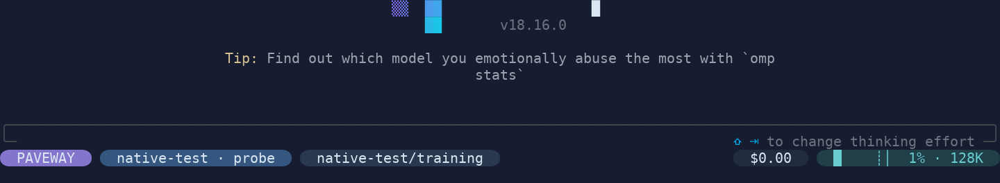

#### 80 列

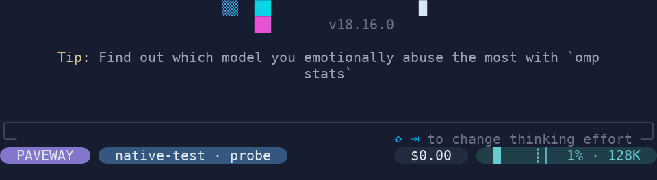

#### 100 列

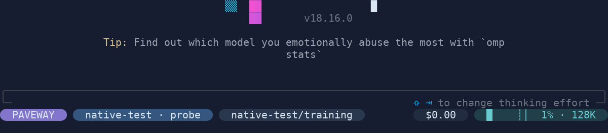

#### 160 列

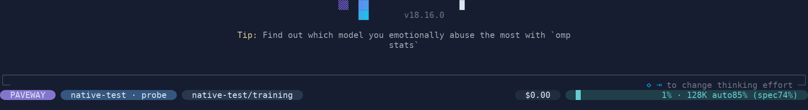

四种宽度实际 Resize 后均保留一条状态栏；80 列省去 Workflow，没有 `wake none`／`Inbox 0`。费用、Context 与身份使用同一套左右对称胶囊。右端完整，不切掉圆帽、不自动换行。

### 待执行、Running、未读和异常

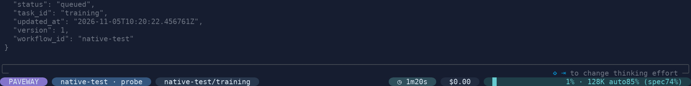

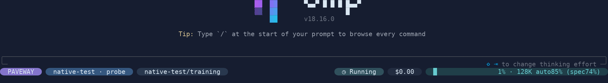

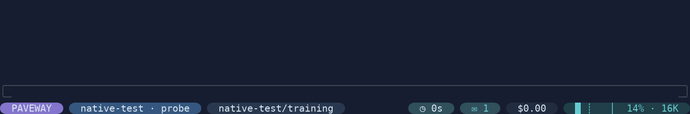

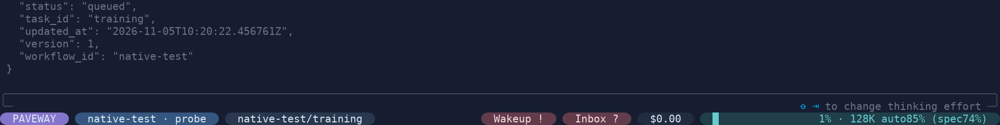

倒计时由实际 `/wakeup in 80s` 创建；Running 来自真正处于执行状态的隔离后台事件。未读来自 Runtime 持久化消息；截图时为 1，未自动确认。未读图的 `◷ 0s` 是轮询已观察到的待执行状态，不把到零当作完成证明。

异常通过暂时重命名 **fixture 根目录内** 的 Unix socket 产生，`finally` 恢复后又实际观察到 [Runtime 恢复](bubble-runtime-recovered-160.png)。没有停用户服务、篡改所有权或人工伪造错误状态。稳定的 `Wakeup ?` 无法在已 admission 的真实链路中单独保持，因此用 renderer 行为测试覆盖；真实异常截图同时证明了 `Inbox ?` 不被伪装成零。

### 长模型与长 Workflow

- [80 列长模型](bubble-resize-80.png)
- [100 列长字段](bubble-resize-100.png)
- [120 列长字段](bubble-resize-120.png)
- [160 列长字段](bubble-resize-160.png)
- [原生 `/new` 后](bubble-session-switch.png)

长字段来自真实模型目录和新建的长 ID fixture workflow。80 列隐藏 Workflow，模型按显示宽度省略；160 列能显示完整长模型，Workflow 保留可读前缀。Resize 期间 `UNSENT_DRAFT` 保留；`/new` 后同一进程仍只有一条状态栏，并实际完成聊天。

### 连续工作帧、空闲与 reduced motion

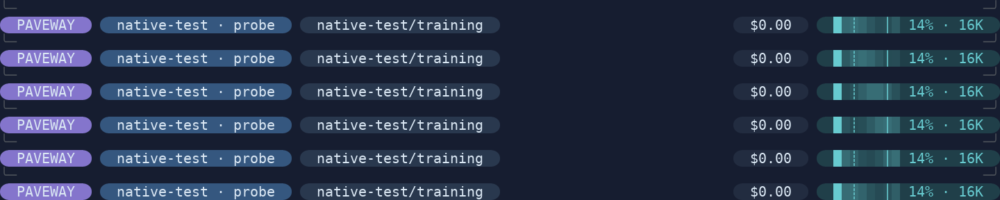

[32 帧真实录制 GIF](bubble-working.gif)，按约 125ms 采样；原始 32 张 `bubble-working-0.png` 至 `bubble-working-31.png` 全部保留。

逐帧审视并核对实际终端单元：这次真实 14%／16K 状态分配 8 格容量条，其中 1 格已用、7 格未用。32 帧文字完全相同；已用格、品牌、身份、Workflow、费用和标签保持不变；颜色变化仅发生在未用区的第 101–107 列（零起算）。取消后静止；工作中关闭 `tui.motion` 也静止。详见 [实际单元审计](bubble-cell-audit.json)、[取消后](bubble-cancelled-idle.png) 和 [motion=false](bubble-motion-disabled.png)。

[95% 真实高占用](bubble-high-context.png) 来自对 4K fixture 窗口提交实际长输入；该用例关闭自动压缩以观察边界，不改变应用统计。

### 无 Nerd Font 降级

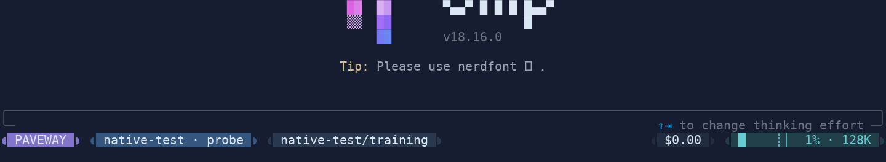

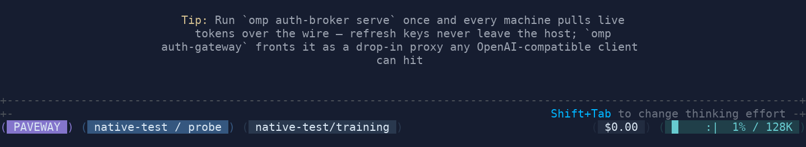

这是实际宿主设置启动的 TUI，而非图片替换字形。Unicode 不输出 PUA，使用对称 `◖`／`◗`；ASCII 使用括号、ASCII 分隔及提示。当前证据字体的普通 Unicode 半圆比 Nerd 圆帽矮，保留为字体降级的真实限制，不用绘制几何圆帽掩盖。256 色、无色、错误宽度字形回退另有实际 renderer 行为测试。

## 旧版对比与修正记录

### 集成基线

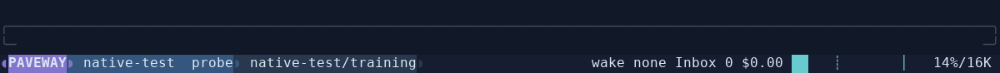

旧版左组是连续色块且共享连接，右组是 `wake none Inbox 0` 等无背景文字；新图中左右每一项均独立封口，空闲右侧只剩费用和 Context。旧图片保留不覆盖，旧测试结果不冒充本轮结果。

### 首轮视觉问题与再次截图

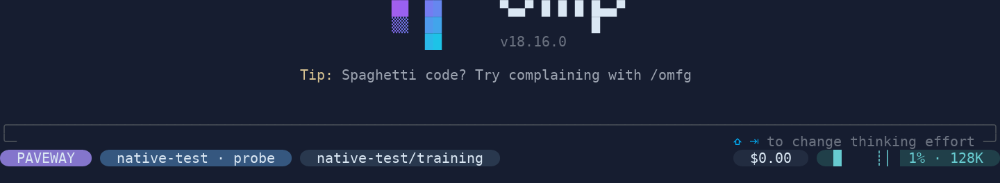

1. 首轮胶囊已独立，但 Context 未使用区仍用状态栏夜色，像在青色组件中挖开一段。只调整 Context 颜色 token，保留原波浪计算；重新跑完整 PTY 并重绘全部图片，最终 120 列图已连成完整青色表面。
2. 首轮行为测试发现“长模型＋异常＋未读”在 100 列会让 Workflow 抢占模型可读前缀。提高主身份最低内容预算到 20 列，再跑测试与长字段实际 Resize 验收。
3. ASCII 初稿身份分隔仍残留中点。改用 ASCII 分隔，实际重启相应 preset 并重新截图。
4. 首轮 PTY 为 7 通过、1 个验收脚本错误：`socket_path` 是字符串，误按 Path 使用。转换成 `Path` 后 focused 场景通过；最终完整 8 项全部通过。

已逐张审视 23 张非工作场景与全部 32 张工作帧：Nerd 圆帽与组件表面衔接、左右配色统一、胶囊分隔可辨、80 列为重新组合而非半截宽屏结果。最终图中的宿主 Logo、随机 Tip、编辑器提示均为真实原生输出，不在本次状态栏改造范围内。

## 验证命令与真实结果

| 检查 | 本轮结果 |
| --- | --- |
| Bubble／Wakeup Bun 行为测试 | 45 通过，0 失败；1854 次断言 |
| 实际 native PTY 场景（最终完整运行） | 8 通过，0 失败；73.073s |
| Python 常规全套 | 421 项，60 跳过，0 失败；119.003s；未启用 native opt-in 的部分另由上述 PTY 验收 |
| 实际捕获单元与配对文件审计 | 55 组 ANSI／JSON 哈希匹配；32 帧仅未用容量单元变化 |

Bun 首轮为 44 通过、1 失败（上述长模型优先级），修正后 45 项通过。取消场景仍有 loopback HTTP `ConnectionResetError` 诊断，相关测试通过；常规 Python 套件还输出 SQLite `ResourceWarning` 和预期的 argparse 错误诊断，没有隐藏或为此扩大修改范围。没有重跑或声称本次改动验证了全部上游 OMP 套件。

```bash
# 使用已有精确缓存；本次没有执行 install.py 或更新 OMP。
CACHE="$HOME/.cache/paveway/omp/18.16.0"
BUN="$CACHE/bun-1.4.4/bin/bun"
export PATH="$(dirname "$BUN"):$PATH"
export NODE_PATH="$CACHE/source-650f3a108229-a5906688ec49/node_modules"

"$BUN" test tests/paveway-statusline.test.mjs tests/paveway-wakeup-status.test.mjs
.venv/bin/python -m unittest discover -s tests
PAVEWAY_TEST_NATIVE=1 \
PAVEWAY_STATUSLINE_EVIDENCE=/tmp/paveway-bubble-evidence \
PYTHONPATH=src:tests \
.venv/bin/python -m unittest test_native_statusline -v

# 截图工具需要 Pillow（仅验收依赖），字体不是应用依赖。
curl --fail --location \
  --output /tmp/Paveway-DejaVuSansMNerdFontMono-Regular.ttf \
  https://raw.githubusercontent.com/ryanoasis/nerd-fonts/v3.4.0/patched-fonts/DejaVuSansMono/Regular/DejaVuSansMNerdFontMono-Regular.ttf
.venv/bin/python tests/render_statusline_evidence.py \
  /tmp/paveway-bubble-evidence \
  --font /tmp/Paveway-DejaVuSansMNerdFontMono-Regular.ttf \
  --wide-font /mnt/c/Windows/Fonts/msyh.ttc \
  --output docs/verification/windline-statusline
```

`--wide-font` 可替换为本机 CJK 字体。最终 55 组原始 ANSI／JSON 保留在 `/tmp/paveway-bubble-evidence/`，首轮对比的配对捕获保留在 `/tmp/paveway-bubble-before-context-fill/`；临时目录不是持久归档。仓库内保留图片、[最终 SHA256 manifest](bubble-rendering-manifest.json)、[首轮对比 manifest](bubble-before-context-fill-manifest.json) 和单元审计，不把运行时会话、凭证或设置复制进仓库。

## 仍有的限制

- 图片是实际 PTY 单元的字体重绘，不是某个桌面终端或硬件栅格器认证；终端字体、行高、字形外观可能不同。Nerd preset 需要对应字体；不具备时选择 Unicode／ASCII，应用不能可靠探测终端实际安装的字形。
- 普通 Unicode 半圆高度由字体决定，不能保证与 Nerd 字形一样满高；ASCII 降级是括号而非实心圆帽。不会假称不支持字形的环境也拥有相同外观。
- 极窄屏幕无法同时容纳所有信息；优先保留异常、未读、模型与 Context，允许隐藏低优先级项。粗粒度容量条中重合的 Compaction 标记可能落在同一格；较宽且有余量时显示完整数值边界。
- 真实故障是隔离 Runtime socket 失联，不是对用户所有权作破坏性测试；未知状态的其他组合由确定性行为测试覆盖。
- 保持既有 OMP 18.16.0／Linux 隔离宿主边界；没有宣称支持其他宿主版本或修改 Alternate Screen 策略。
