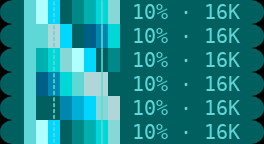
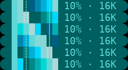
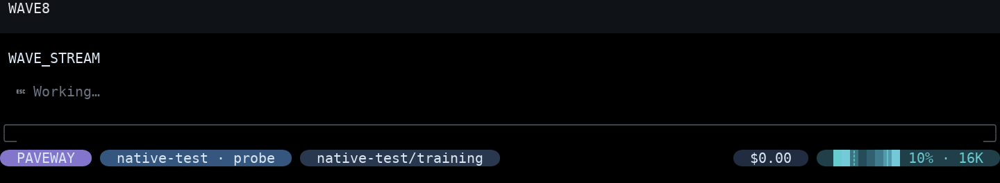
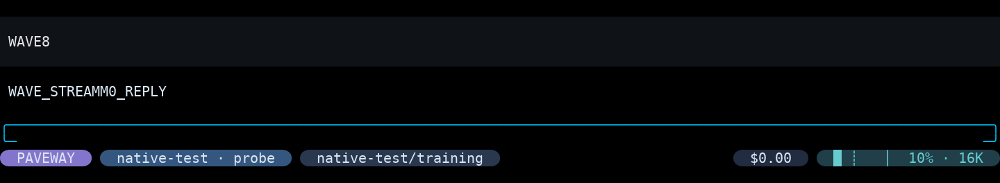

# Context 青蓝波浪：真实 OMP/PTY 验收

## 设计与边界

原余弦波只在 Context 表面与 cyan 之间混合 8%–34%，32 帧耗时 4 秒；短条经 ANSI-256 量化后只剩 23、24 两种近色。新实现保留占用量化和所有 Bubble/业务逻辑，只替换未用容量的颜色取样。

参考的真实实现：

- [wind.lua](https://github.com/windwp/windline.nvim/blob/master/lua/wlsample/wind.lua)：各 wave highlight 使用不同起始下标，150ms 更新。
- [effects.list_color](https://github.com/windwp/windline.nvim/blob/master/lua/wlanimation/effects.lua)：颜色列表按下标递增，末尾回到开头；每个效果保留自己的下标。
- [highlight_anim.lua](https://github.com/windwp/windline.nvim/blob/master/lua/wlanimation/highlight_anim.lua)：同一次 tick 缓存同名颜色，使引用同色的高亮同步更新。
- [utils.lua](https://github.com/windwp/windline.nvim/blob/master/lua/windline/utils.lua) 与 [cterm_utils.lua](https://github.com/windwp/windline.nvim/blob/master/lua/windline/cterm_utils.lua)：动画产生 RGB，高亮层按 termguicolors 决定是否转换到 cterm；对比足够的颜色列表比窄幅渐变更能保留流动层次。

Paveway 只借用循环颜色列表与空间错相思想，不引入 Lua、Neovim 或第二个计时器。

### 运动模型

- 既有 OMP 工作状态计时器每 125ms 推进一个 phase；宿主补丁不变。
- 未用区域第 `position` 格的起始偏移为 `round(position * 16 / remaining)`。
- 色表下标为 `(offset - phase) mod 16`：随时间向右平移，16 帧周期为 2 秒。
- 色表有渐亮拖尾、克制的亮青波峰和回落段；首尾是同一循环序列，不重建场景。
- 剩余 1–2 格保持 Context 深青表面，不做高占用闪烁；占用未知、空闲、motion=false 和全满也静止。
- 已用区域固定实心 cyan；圆帽、padding、标签和 Compaction 标记位置均不变。

### 最终调色板（候选 B）

| 下标 | True Color RGB | ANSI-256 | ANSI RGB |
| --- | --- | --- | --- |
| 0 | `#203f49` | 23 | `#005f5f` |
| 1 | `#224450` | 23 | `#005f5f` |
| 2 | `#264c59` | 24 | `#005f87` |
| 3 | `#2b5664` | 30 | `#008787` |
| 4 | `#316170` | 31 | `#0087af` |
| 5 | `#386e7e` | 37 | `#00afaf` |
| 6 | `#407b8d` | 38 | `#00afd7` |
| 7 | `#49899c` | 44 | `#00d7d7` |
| 8 | `#5299ac` | 45 | `#00d7ff` |
| 9 | `#5caabd` | 80 | `#5fd7d7` |
| 10 | `#69bdce` | 116 | `#87d7d7` |
| 11 | `#73c9d7` | 116 | `#87d7d7` |
| 12 | `#7fd8e2` | 152 | `#afd7d7` |
| 13 | `#74cad8` | 116 | `#87d7d7` |
| 14 | `#5aa9ba` | 45 | `#00d7ff` |
| 15 | `#3a7483` | 23 | `#005f5f` |

ANSI-256 的 11 个不同色号是显式设计，不是先生成窄幅 RGB 再祈求最近色量化。两种色深共用同一下标运动，不维护两套动画算法。已用 cyan 仍是 `#67cbd0`／80，静态表面仍是 `#203f49`／23。

## 实际候选比较与修正

两组都经过真实 Paveway → PTY guardian → OMP 18.16.0 → trusted extension → StatusLine 链路录制；不是手工构造 renderer snapshot。

- A：RGB 波峰 `#86e7ef`，ANSI 波峰 159 (`#afffff`)，两侧 152。宽条上近白波峰过于醒目，和常亮已用 cyan 争夺注意力。
- B（采用）：RGB 波峰 `#7fd8e2`，ANSI 波峰降到 152，两侧 116；回落段也调整。仍能辨认移动波峰和拖尾，但高亮不再接近白色。256 色仍保留明显青蓝层次，不出现灰块。
- 4 格条的运动必然是整格可见移动；保留渐变，不伪造子单元像素。仅余 1–2 格直接静态，避免随机闪色。
- 最初按固定 wall-clock 间隔加文件写入采样会偶尔重复／漏掉 phase。最终捕获等待实际状态行发生重绘变化，记录 17 帧，并断言第 16 帧等于第 0 帧；GIF 使用前 16 帧。
- GIF 延迟只能以 10ms 表示，因此编码交替 120/130ms，平均 125ms、总周期恰为 2 秒；运行时仍是原生 125ms。

A 的实际六帧对照：



B 的实际六帧对照：



## 最终真实 GIF 与截图



动画 GIF 和六帧图只裁切实际 Context 胶囊，便于观察短条；上图保留完整宿主画面。每个动态场景的 17 个捕获单元满足 `frame[16] == frame[0]`，前 16 帧全部不同。[单元与文件 SHA-256 审计](audit.json) 记录了实际占用格、未用颜色、变化列和循环闭合结果。


| 场景 | GIF | 多帧对照 |
| --- | --- | --- |
| 8 格、True Color | [播放](bubble-wave-8-truecolor.gif) | [六帧](bubble-wave-8-truecolor-frames.png) |
| 8 格、ANSI-256 | [播放](bubble-wave-8-256.gif) | [六帧](bubble-wave-8-256-frames.png) |
| 16 格、True Color | [播放](bubble-wave-16-truecolor.gif) | [六帧](bubble-wave-16-truecolor-frames.png) |
| 16 格、ANSI-256 | [播放](bubble-wave-16-256.gif) | [六帧](bubble-wave-16-256-frames.png) |
| 4 格、True Color | [播放](bubble-wave-4-truecolor.gif) | [六帧](bubble-wave-4-truecolor-frames.png) |
| 半数格已用 | [播放](bubble-wave-50-truecolor.gif) | [六帧](bubble-wave-50-truecolor-frames.png) |
| 高占用、极短余量 | [静态录制](bubble-wave-high-truecolor.gif) | [六帧](bubble-wave-high-truecolor-frames.png) |
| motion=false | [静态录制](bubble-wave-motion-off.gif) | [六帧](bubble-wave-motion-off-frames.png) |



截图百分比与实际格数来自宿主，不改写成示意数据：短提示占用 1/8 或 1/16；半满用例显示约 56%，向下量化为 8/16 格；高占用约 91%，14/16 格已用，剩余两格静态。4 格用例通过真实、远期 Wakeup 的稳定小时／分钟标签压缩布局，不修改 renderer 预算。

全部 GIF／PNG 都是实际 PTY 单元的字体重绘。黑色只是证据背景，对应运行时 ANSI 默认背景；不是 Windows Terminal GUI 截图，不能证明其像素栅格化或字体行高。原始 ANSI／JSON 留在 `/tmp/paveway-wave-final`；仓库只保存 fixture 图像及不含用户配置、凭证和会话的哈希审计。

## 复现

```bash
bun test tests/paveway-statusline.test.mjs tests/paveway-wakeup-status.test.mjs
PYTHONPATH=tests:src PAVEWAY_TEST_NATIVE=1 \
  PAVEWAY_STATUSLINE_EVIDENCE=/tmp/paveway-wave-final \
  .venv/bin/python -m unittest tests.test_native_statusline -v
.venv/bin/python tests/render_statusline_evidence.py /tmp/paveway-wave-final \
  --font /tmp/Paveway-DejaVuSansMNerdFontMono-Regular.ttf \
  --wide-font /mnt/c/Windows/Fonts/msyh.ttc \
  --context-only --output /tmp/paveway-wave-render-final
```

本轮最终结果：Bun 两个状态栏测试文件共 **57 passed / 0 failed**；开启证据捕获的完整原生状态栏套件 **12 tests / OK，148.600s**。取消流式请求时 loopback fixture 会打印 `ConnectionResetError`，对应测试仍通过；没有改变服务器实现来隐藏它。首次完整采集另暴露了捕获器在 Runtime 故障期间查询 socket 的问题，修正为缓存同一 Terminal 的初次宿主元数据，保留原有环境证据；最终完整套件含断联／恢复用例通过。


字体只是重绘证据输入，不是运行时依赖。单测独立检验向右传播、完整周期、足够颜色层次、短条静态、占用和外部单元不变；PTY 用停止后的静态条确定占用前缀，再检查所有动画帧只能改动其后的未用格。停止、会话切换、motion=false、窄屏和原有业务验收仍保留。
